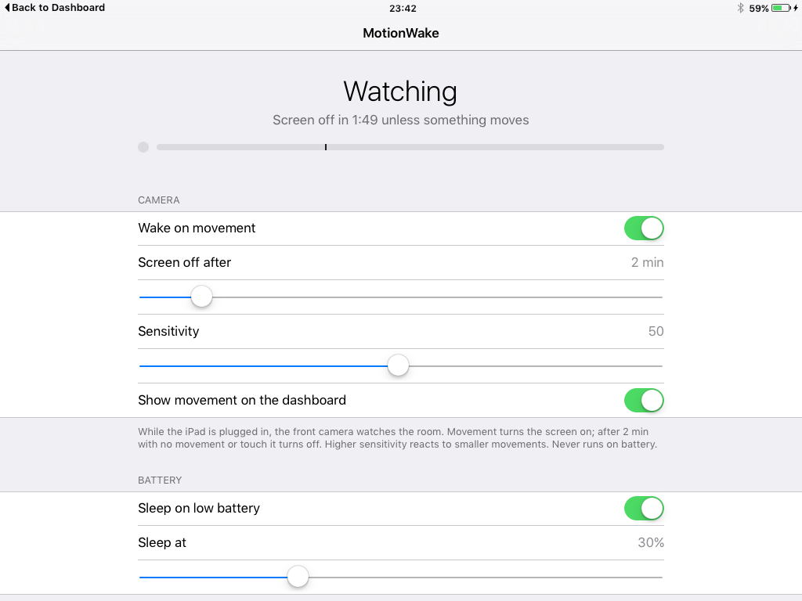
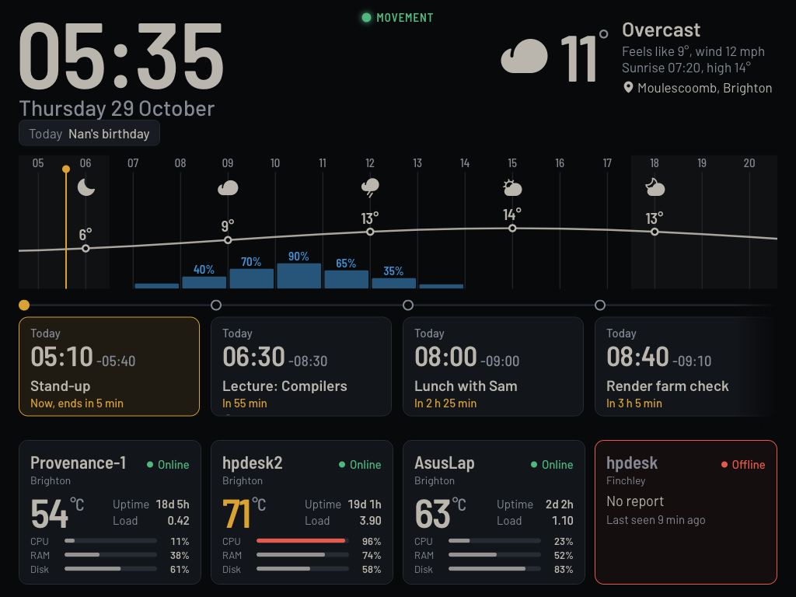

<div align="center">


# MotionWake

**Turns an iPad's screen on when someone walks into the room, and off again once the room goes still.**

For a jailbroken iOS 9 iPad used as a wall display. Built for, and tested on, an iPad mini 1 (iPad2,5)
on iOS 9.3.5 with the iocaste jailbreak, running [iPad Dashboard](https://github.com/LBSiUK/ipad-dashboard).

[**Download the .deb**](https://github.com/LBSiUK/MotionWake/releases/latest) · or add [repo.lbsi.uk](https://repo.lbsi.uk/) in Cydia



</div>

## What it does

- **Movement turns the screen on.** While the iPad is plugged in, the front camera watches the room
  five times a second. When something moves, the screen comes on and the iPad unlocks straight into
  your dashboard.
- **Stillness turns it off.** After 2 minutes with no movement and no touch, the screen goes off.
- **Only on power.** Unplugged, the camera stays off and the iPad behaves as normal.
- **Sleep on low battery.** On battery at 30% or less, the iPad goes to sleep once it has been left
  untouched for those same 2 minutes, so a dashboard that has lost its cable doesn't run flat.
- **Locking by hand wins.** Press the sleep button and the screen stays off until the room has been
  still for 30 seconds, so walking away doesn't switch it straight back on.
- **A movement marker for tuning.** The dashboard can show a small light whenever the camera sees movement.

Nothing the camera sees is saved or sent anywhere. Each frame becomes a grid of 432 brightness
averages in memory, is compared with the frame before, and is dropped.

<p align="center"></p>
<p align="center"><sub>The movement marker at the top of iPad Dashboard. The screenshot uses the dashboard's <code>--mock</code> data.</sub></p>

## Installing

In Cydia, go to Sources, tap Edit, then Add, and enter `https://repo.lbsi.uk/`. Then install MotionWake.

Without Cydia, download the `.deb` from [Releases](https://github.com/LBSiUK/MotionWake/releases),
copy it to the iPad, and run `dpkg -i uk.lbsi.motionwake_1.0.0_iphoneos-arm.deb` as root.

The service starts straight away, and the MotionWake app appears on the home screen. Then:

1. Set **Settings › General › Auto-Lock** to **Never**. MotionWake does the locking. iOS's own timer
   knows nothing about movement and would lock the screen with people in the room.
2. Add your dashboard to the home screen from Safari (Share, then Add to Home Screen) so that it opens
   full screen. MotionWake wakes into the full-screen web clip called "Dashboard", or failing that the
   first full-screen one it finds. With none, it unlocks to the home screen.

MotionWake has only been used without a passcode.

## Settings

| Setting | Default | |
|---|---|---|
| Wake on movement | On | Off leaves the screen alone, and the camera never runs. |
| Screen off after | 2 min | 30 s to 15 min, in half-minute steps. Counts from the last movement or touch. |
| Sensitivity | 50 | 1 to 100. Higher reacts to smaller movements. |
| Show movement on the dashboard | On | The marker on the dashboard page. Handy while tuning. |
| Sleep on low battery | On | Only ever applies on battery. |
| Sleep at | 30% | 5% to 90%, in 5% steps. |

The top of the app shows what the service is doing right now (Watching, Movement, On battery,
Locked by hand or Off) and how long until the screen goes off. The bar under it is the live movement
level: how much of the picture changed in the last frame. The tick marks what the current sensitivity
needs, and the bar turns green when movement passes it. To tune it, walk about and move the
Sensitivity slider until people cross the tick and the curtains don't.

## How it works

`motionwaked` is a root LaunchDaemon. The iocaste jailbreak has no Mobile Substrate, so nothing is
injected into SpringBoard. MotionWake uses SpringBoard's and backboardd's own client calls, which its
entitlements allow.

- **Watching.** The front camera runs at its Low preset (192×144) at 5 fps. Each frame's brightness is
  averaged into a 24×18 grid and compared with the previous frame. A change across the whole picture
  (auto exposure, a lamp switched on) is taken out first, so only local change counts. Movement means
  enough cells changed in two frames running: at sensitivity 50, 6% of the picture by 16 grey levels;
  at 100, 1% by 6.
- **Screen on.** `SBSOpenSensitiveURLAndUnlock` with the clip's `webapp:` URL unlocks straight into the
  dashboard's web clip, and the page that was already running comes back as it was.
- **Screen off.** `SBSLockDevice`.
- **Touches.** `BKSHIDServicesLastUserEventTime` says when the screen was last touched, so someone
  reading the dashboard without moving much keeps it on.
- **Staying awake.** While watching, the daemon holds a `PreventUserIdleSystemSleep` assertion.
  Without it the iPad would sleep once the screen is off, and the camera would stop. On battery it
  holds nothing.
- **Light changes.** For 3 s after the screen turns on or off, frames are ignored, because the
  screen's own light changes the picture.
- If the screen comes on with no movement or touch (a notification, say), MotionWake turns it off again.

The daemon's entitlements: `com.apple.private.tcc.allow` (`kTCCServiceCamera`, so no camera prompt),
`com.apple.springboard.launchapplications`, `com.apple.springboard.debugapplications`,
`com.apple.springboard.opensensitiveurl`, `com.apple.backboard.client` and
`com.apple.backboardd.lastUserEventTime`.

Settings live in `/var/mobile/Library/Preferences/uk.lbsi.motionwake.plist`. The daemon rereads them
on a Darwin notification when the app saves. The log is `/var/mobile/Library/Logs/MotionWake.log`:

```
2026-10-29 19:59:35 screen off: still for 121 s
2026-10-29 20:03:53 screen on: movement 7.4%
2026-10-29 21:26:16 not watching: on battery
2026-10-29 21:28:48 watching (on power)
```

### Status for a web page

The daemon answers `GET http://127.0.0.1:8095/status` on the iPad itself (loopback only):

```json
{"state":"watching","external":true,"battery":59,"motion":false,"level":0.0,"needed":6.0,
 "luma":145,"fps":5,"stillFor":36,"timeout":120,"screen":"off","showDot":true,
 "sleepLow":true,"sleepBelow":30}
```

The app polls it twice a second. It sends `Access-Control-Allow-Origin: *`, so a page open on the iPad
can read it too. That is how the dashboard marker works. In Safari 9 (ES5):

```js
var marker = document.getElementById('motion');
function poll() {
  var x = new XMLHttpRequest();
  x.open('GET', 'http://127.0.0.1:8095/status');
  x.timeout = 2000;
  x.onload = function () {
    var s = JSON.parse(x.responseText);
    marker.hidden = !s.showDot;
    marker.className = s.motion ? 'on' : '';
    setTimeout(poll, s.showDot ? 400 : 10000);
  };
  x.onerror = x.ontimeout = function () { setTimeout(poll, 60000); };
  x.send();
}
poll();
```

## Building

You need Xcode, plus `ldid` and `dpkg` (`brew install ldid dpkg`).

```
tools/make_sdk.sh          # once: builds ~/sdks/iPhoneOS9.3-armv7.sdk
./build.sh                 # build/uk.lbsi.motionwake_1.0.0_iphoneos-arm.deb
./build.sh install         # also installs it on root@192.168.0.161 (IPAD=... to change)
```

Today's Xcode still links 32-bit armv7, with three workarounds that `make_sdk.sh` and `build.sh`
take care of. [ChargeCap's README](https://github.com/LBSiUK/ChargeCap#building) explains them.
On the device, replace binaries by rename and never overwrite them in place: iOS caches the old
code signature and kills the new binary with `Killed: 9`. `dpkg` already does it that way.

## Uninstalling

Remove MotionWake in Cydia, or run `dpkg -r uk.lbsi.motionwake`. Purging the package also deletes the
settings and the log. Put Auto-Lock back to how you had it.

## Limits

- Tested only on an iPad mini 1 on iOS 9.3.5. The package is armv7, so other 32-bit iOS 9 iPads may
  work, but none has been tried.
- The camera needs light to see by. In a dark room, movement may not register.
- A wake always opens the dashboard, even if another app was in front when the screen went off.
